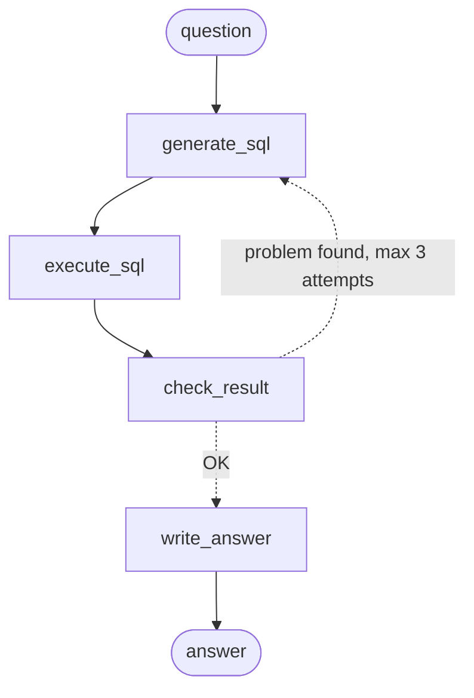

# Talk to Your Data — an AI agent that answers business questions in plain language

**Context.** Business teams (marketing, sales, operations) constantly need figures from their data warehouse, but most of them cannot write SQL. Every question goes through the data team, and answers take time.

**Goal.** Build an AI agent that lets a manager ask a question in natural language — *"What was the revenue in the South region last month?"* — and get a correct, explained answer in seconds, straight from the database.

**The real challenge** is not writing SQL: modern LLMs are good at that. It is making sure the agent uses the **company's own business definitions** (what counts as revenue, as a customer, as a late delivery...). A query can run perfectly and still return a wrong number.

---

## Results

Accuracy = share of questions where the agent's query returns the same result as a reference query written by hand (*execution accuracy*).

| System | Tuning set (30 questions) | Held-out set (10 new questions) |
|---|---|---|
| LLM with the database schema only | 37% | 50% |
| + semantic layer (data dictionary + business glossary) | 90% | 100% |
| + LangGraph agent (check-and-fix loop) | 100% | 100% |

**Key takeaways**
- **Without business definitions, the LLM writes valid SQL that gives wrong answers**: revenue overestimated by ~20% (shipping costs and canceled orders included), a repeat purchase rate of 0% instead of 3% (wrong customer identifier), "last month" interpreted as a nearly empty month.
- **The semantic layer fixes errors of meaning**; **the agent's check-and-fix loop fixes execution errors** (queries that crash), by sending the error back to the LLM.
- The semantic layer **generalizes**: it reaches 100% on 10 questions that were never used to tune it.

> ⚠️ These figures come from small test sets and a single run each: they show a clear trend, not a precise accuracy. See [Evaluation](#evaluation) for the method and its limits.

---

## How it works



The agent is built with **LangGraph** and works like a careful analyst:

1. **`generate_sql`** — the LLM (Mistral) writes a SQL query, using the database schema and the semantic layer.
2. **`execute_sql`** — the query runs on the database, in **read-only** mode.
3. **`check_result`** — rule-based checks, without any LLM: did the query fail? Is the result empty or only NULL? Does a "how many" question return several rows instead of one number?
4. If a problem is found, the agent **loops back** with the error message and fixes its query (up to 3 attempts).
5. **`write_answer`** — the LLM turns the result into a short answer for a business user, in the language of the question. It may only use figures that appear in the result, and must state the period they refer to.

**Design principle:** facts are computed by the database, never guessed by the LLM. For example, the period ("August 2018") is returned as a column of the query result, so the answer cannot cite a wrong month.
### Example: the check-and-fix loop in action

On the tuning set, the simple chain (semantic layer, no loop) produced 3 queries that crashed. The LangGraph agent, which sends the database error back to the LLM, recovered from them:

| Question | Simple chain (no loop) | LangGraph agent |
|---|---|---|
| Q10 — What was the revenue in 2017? | ❌ `Binder Error: WHERE clause cannot contain aggregates` | ✅ fixed at the 2nd attempt |
| Q16 — What percentage of reviews are negative? | ❌ `Binder Error: column "total" must appear in the GROUP BY clause` | ✅ fixed at the 2nd attempt |


For example, on Q16, the simple chain wrote a query that the database rejected:

```sql
WITH total_reviews AS (
    SELECT COUNT(*) AS total FROM reviews
)
SELECT (COUNT(CASE WHEN review_score <= 2 THEN 1 END) * 100.0 / t.total) AS negative_review_percentage
FROM reviews, total_reviews t
-- Binder Error: column "total" must appear in the GROUP BY clause
```

The agent received this kind of error message, and rewrote a simpler, valid query:

```sql
SELECT (COUNT(CASE WHEN review_score <= 2 THEN 1 END) * 100.0 / COUNT(*)) AS negative_review_percentage
FROM reviews
```
---

## Semantic layer

The agent receives two documents, written for this project:
- [`knowledge/data_dictionary.md`](knowledge/data_dictionary.md): what each table and column really means, and its pitfalls.
- [`knowledge/business_glossary.md`](knowledge/business_glossary.md): the official definition of each business metric, with a reference SQL query.

Main business decisions:

| Metric | Definition |
|---|---|
| Revenue | Sum of item prices of **delivered** orders, **excluding shipping** |
| Customer | A real person (`customer_unique_id`), not `customer_id`, which is created for each order |
| Number of orders | All orders except canceled and unavailable ones |
| Late delivery | Delivered after the promised date, compared **at day level** |
| Negative review | Score of 1 or 2 |
| "Last month", "recently" | The last **complete** month (at least 1,000 orders) — August 2018 |
| "This month" | The current month (October 2018), flagged as incomplete in the answer |

**Data insight:** the activity in the dataset actually ends in August 2018. September (16 orders) and October 2018 (4 orders) only contain residual, almost all canceled orders. Without this rule, "orders last month" would return 4 instead of 6,512.

---

## Evaluation

- **Method:** each question has a reference SQL query (`gold_sql`). The agent's query and the reference query are both executed, and their **results** are compared (not the SQL text). The comparison ignores column order, row order and extra columns, and treats a ratio (0.03) and a percentage (3%) as equal.
- **Statuses:** `PASS` (correct result), `FAIL` (the query runs but the result is wrong), `ERROR` (the query crashes).
- **Two test sets:** a tuning set of 30 questions (easy / business / combined), used to improve the semantic layer, and a **held-out set** of 10 new questions, never used for tuning and run only once.
- **Limits:** small test sets (one question = 3 to 10 points), one run per configuration while LLM outputs vary from one run to another, and held-out questions written by someone who knew the glossary.

---

## Tech stack

| Layer | Tools |
|---|---|
| LLM | Mistral (`mistral-medium`) via API |
| LLM framework | LangChain (prompts, chains), LangGraph (agent) |
| Database | DuckDB |
| Data | Python, pandas, SQL |
| Evaluation | Custom execution-accuracy harness (Python, YAML test sets) |
| BI | Power BI (DAX measures consistent with the business glossary) |

---

## Getting started

1. **Clone the repository and install the dependencies**
```bash
   git clone https://github.com/QuiterieGuignard/agents_talk_to_your_data.git
   cd agents_talk_to_your_data
   python -m venv
